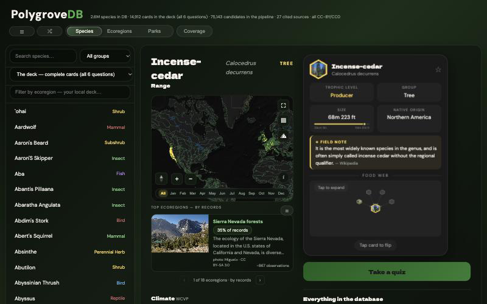

# PolygroveDB

**An open, reproducible species database for every ecoregion on Earth.** It joins
more than 20 openly licensed scientific datasets, over the 2.6 million species
of the GBIF backbone, into a deck of 14,911 species across the 847 RESOLVE 2017
ecoregions, with taxonomy, feeding role, body size, food
web, habitat, native origin and where each species is actually recorded.

**Explore it:** https://polygrovedb.pages.dev
· It powers the [Polygrove](https://github.com/polygroveapp/polygrove-app) trading
card game, which also runs in the browser at https://polygrovedb.pages.dev/app/

<p>
  
</p>

## What's in it

| | |
|---|---|
| Species cards | 14,911 across 847 ecoregions |
| Feeding roles | 6,550 producers, 4,430 carnivores, 2,906 herbivores, 1,018 omnivores, 7 decomposers |
| Sources | more than 20 datasets, all CC0, CC BY or MIT, listed in [DATA_SOURCES.md](DATA_SOURCES.md) |
| Provenance | every fact on a card records which source it came from and how confident it is |

Each card answers six quiz questions: taxonomy, feeding guild, size, food web,
habitat or origin or biome, and which of three look-alike cards is yours.

## How it's built

A Python pipeline over DuckDB, written as percent-format notebooks
(`# %%`) so every step runs as a script and reads as a notebook. One file,
[`build/run_all.py`](build/run_all.py), defines the execution order.

```
build/00_substrate/  GBIF backbone taxonomy, RESOLVE ecoregions, a name resolver
                     that reconciles synonyms across every source
build/10_sources/    one notebook per trait source: birds, mammals, reptiles,
                     amphibians, fish, insects, spiders, plants
build/20_derive/     joins and transforms: occurrences × ecoregions, species ranges,
                     trait crosswalks, Wikipedia field notes, plant growth forms
build/30_output/     what ships: catalog.json, quiz data, photos, framing, sea masks
explorer/            the website: a static site on Cloudflare Pages with a MapLibre map
```

Some of the harder problems it solves:

- **Name resolution.** Sources spell the same species differently. A resolver
  over the GBIF backbone maps names and synonyms to one accepted species, which
  raised trait coverage 8× for feeding roles and 258× for habitats.
- **Licence filtering at the record level.** GBIF occurrences are kept only when
  the individual record is CC0 or CC BY, and sources that turned out to be
  non-commercial were dropped and documented.
- **Fair quiz decoys.** Wrong answers are drawn like-with-like, so a plant is
  never offered alongside an obvious insect.
- **Reproducibility.** The clean-rebuild test runs the whole chain into an empty
  database and diffs the result against the shipped catalog.

The raw inputs, well over 100 GB of public dumps, are not in this repo.
[DATA_SOURCES.md](DATA_SOURCES.md) links to each one.

## Running it

```bash
python3 build/run_all.py --list               # show the pipeline
python3 build/run_all.py                      # run it end to end (hours)
python3 build/run_all.py --from resolve_rejoin  # resume mid-chain
```

It needs Python with DuckDB, pandas and rasterio, and the source dumps in `data/`.

## Licence

The database is built only from openly licensed data; see
[DATA_SOURCES.md](DATA_SOURCES.md) for every source, its licence and its citation.
Wikipedia text and photos are used by the app at runtime with attribution and
are never stored in the database.
